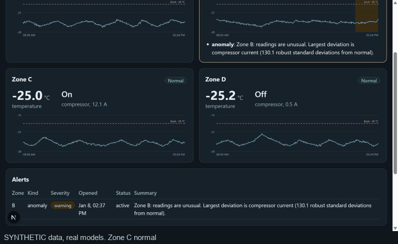

# ColdChain AI

An AI control tower for a simulated automated cold store: computer vision on dock cameras,
freezer anomaly detection and breach prediction, volume forecasting, slotting, incident
text classification, and an LLM assistant that answers from the platform's own data.

> **Status: partial build.** Done: the sensor simulator, the data plane, two freezer models (anomaly
> detection, breach early warning) with a real-data sanity check, an incident-report classifier
> (DistilBERT, ONNX int8), the model-serving API for all three, and the `core` service (ingest,
> history, alerts with acknowledgement and an optional webhook, incident reports, shared-key auth, opt-in
> retention), the drift monitor with a Prometheus/Grafana setup (config-validated only, never run), and a live
> dashboard (Next.js). **Not built yet:** demand forecasting and slotting
> (waiting on the M5 dataset), computer vision (YOLO, tracking, OCR), the LLM assistant, and any cloud
> deployment. The results table holds measured numbers only.

Inspired by public descriptions of highly automated frozen warehouses. It is not affiliated
with, and does not use data from, any real operator. **All sensor data and all incident text are
synthetic** (see [docs/data-sheet.md](docs/data-sheet.md)); the only real data used is one public
machine-temperature series for a sanity check.

Plan and architecture: [docs/PROPOSAL.md](docs/PROPOSAL.md). Dashboard: [docs/dashboard.md](docs/dashboard.md).
Resume bullets and interview Q&A: [docs/interview-notes.md](docs/interview-notes.md).



_Screen capture of the dashboard (Next.js) replaying a **synthetic** door-left-open fault at about 1.5 simulated
minutes per second, scored by the real trained models. Zone C: normal, breach-risk warning, then breached._

## Quick start

```bash
uv sync --all-packages          # install the workspace (PyTorch is NOT included, see below)
uv run pytest                   # unit tests; integration tests need real NATS/Postgres/Redis and run in CI
uv run python -m coldchain_simulator generate --out data/synthetic/freezer
cp .env.example .env
docker compose --profile core up -d --build   # NATS, Postgres/Timescale, Redis, MinIO, MLflow
```

Serve the models (details and measured latency in [docs/ml-api.md](docs/ml-api.md)):

```bash
uv run python -m coldchain_ml.registry.promote      # refit, verify against reported metrics, register
uv run uvicorn coldchain_ml_api.app:create_app --factory --port 8081
```

The incident classifier's weights are not in the repository. Rebuilding them needs the opt-in PyTorch
group (about 1 GB) and 17 to 30 minutes of CPU per training run; the steps are in the
[model card](docs/model-cards/incident-nlp.md#reproduce). Without them the incident endpoint answers 503
and everything else works.

The whole pipeline (details in [docs/core.md](docs/core.md)):

```bash
docker compose --profile core --profile ml --profile app --profile sim up -d --build
curl http://localhost:8000/v1/zones      # live zones, then: curl -N http://localhost:8000/v1/stream
```

MLflow: http://localhost:5000 · MinIO console: http://localhost:9001 · NATS monitor: http://localhost:8222

Dashboard http://localhost:3000 (the `app` profile). Drift monitor, Prometheus and Grafana:
add `--profile observability` (Grafana http://localhost:3001, monitor http://localhost:8090/v1/drift).

**Without Docker**, to see the dashboard working: register the models, start the ml-api, then
`uv run python scripts/demo_stack.py` (real `core` logic and scorer on in-memory storage, replaying a synthetic
fault) and `cd dashboard && npm ci && npm run dev`. Steps in [docs/dashboard.md](docs/dashboard.md#run-it).

## Repo layout

```
libs/coldchain_schemas/   shared event schemas (NATS payloads, alerts, ground-truth labels)
services/simulator/       synthetic freezer sensors with labelled faults (offline + live NATS)
services/ml-api/          FastAPI model serving: three models loaded from the MLflow registry
services/core/            NATS ingest -> Postgres history, scoring orchestration, alerts, REST + SSE API
services/monitor/         drift checks (PSI) on live inputs and model scores, Prometheus metrics
dashboard/                Next.js live dashboard (zones, alerts, drift)
ml/                       training, evaluation, serving classes and model-registry code
scripts/                  data download (NAB), benchmarks, contract checks
infra/                    compose helpers, MLflow image, Prometheus and Grafana config
docs/                     proposal, data sheet, service docs, model cards, generated results
```

## Results

Every row has a baseline, a stated split and a model card or doc. Rows are added as models are evaluated.

| Task | Data | Baseline | Best simple method / model | Key result | Card |
|---|---|---|---|---|---|
| Freezer anomaly detection | **Synthetic** (176 test events) | z-score: event-F1 0.93, drift caught after ~3 days | Robust z-score on temperature + compressor current + compressor-off duration | Event-F1 **0.95** (baseline 0.93); drift caught in **~6 h (12x earlier)**; power cuts caught **0.97** vs 0.80. Isolation forest did not beat it. The off-duration rule was added after seeing the test power-cut recall (see the card). | [card](docs/model-cards/anomaly.md) |
| Breach early warning (-18 C within 30 min) | **Synthetic** (188 test breaches) | Current-temperature threshold: PR-AUC 0.31, warned >=5 min 0.62, 0.22 false alarms/zone-day | LightGBM, regularised, 6 training histories | PR-AUC **0.57**, warned >=5 min **0.72**, **0.03** false alarms/zone-day. At matched false-alarm budgets it beats both baselines everywhere (0.96 vs 0.62 warned at 0.22/zone-day; 0.80 at 0.03). Misses most drift breaches at the F1-tuned point (0.42), far fewer at a 0.10 budget (0.92). | [card](docs/model-cards/breach.md) |
| Anomaly detection, **real-data sanity check** | NAB machine temperature (real, 3 scorable failures) | Chance level via shifted alarms | Robust z-score with a threshold tuned on the *synthetic* data | 2 of 3 failures, 0.00 false alarms/day (chance 0.20, P=0.04). Isolation forest and rolling z-score look better on paper but match chance. Sanity check only. | [card](docs/model-cards/anomaly.md) |
| Incident classification (4 classes) | **Synthetic** text; test = 960 reports from unseen template families, plus 120 hand-written | TF-IDF + logistic regression: macro-F1 **0.755** test / **0.799** independent | DistilBERT fine-tuned, 3 seeds, served as ONNX int8 | **No measurable gain over the baseline:** 0.733 ± 0.014 test, 0.792 ± 0.067 independent. **On 3,000 real OSHA injury reports** (all should be `safety`) DistilBERT says safety for **0.89** (0.83 of 340 cold-store reports; some misses scored above 0.9) while the TF-IDF baseline manages **0.34**: the tie on synthetic text did not survive real text. int8 is 4.0x faster than PyTorch on one thread (82 to 21 ms) and 4x smaller, but its labels depend on the batch, so it scores one report at a time. | [card](docs/model-cards/incident-nlp.md) |
| Model serving (ml-api) | Real 1-minute windows from simulator histories; incident reports | n/a (service) | FastAPI, three models from the MLflow registry, features shared with training | One worker: anomaly p50 36 ms / p95 56 ms, breach p50 98 / 109 ms, incident (1 report) p50 28.5 ms. Does not scale with threads (GIL). A registry gate refused one model for a real problem. | [doc](docs/ml-api.md) |
| Pipeline (`core`) | Simulated 7-day history through real NATS, TimescaleDB, Redis (CI) | n/a (plumbing) | Idempotent ingest, scorer that never skips minutes, alert state machine | Stored exactly once (also after republishing); alerts equal the offline expectation. On a real 22-min door fault: breach-risk warning 6 min before the crossing. | [doc](docs/core.md) |
| Drift monitor | Synthetic zone-days (360), with injected sensor bias and compressor drift | n/a (statistics) | PSI on live inputs vs training reference; PSI on model scores vs early baseline | 1 of 272 anomaly-free days flagged; every injected shift (+0.5 C, current +10%, stuck compressor) flagged on 272 of 272. Easy case: low-noise synthetic data. | [doc](docs/monitor.md) |

_Synthetic-data results measure fit to my simulator and generator, not real-world performance._

## Not done yet (so nobody has to guess)

Demand forecasting and slotting (needs the Kaggle M5 data), computer vision (detector, tracking,
OCR, damaged-pallet classifier, RTSP worker), the LLM assistant, cloud deployment, any evaluation of the other incident classes on real text, and per-user authentication (the services take one shared API key; there are no accounts). **Never run:** the full Compose stack (CI builds the images and runs
the integration tests; nothing has brought the whole stack up in Docker, including the monitor, Prometheus,
Grafana and the dashboard image).
